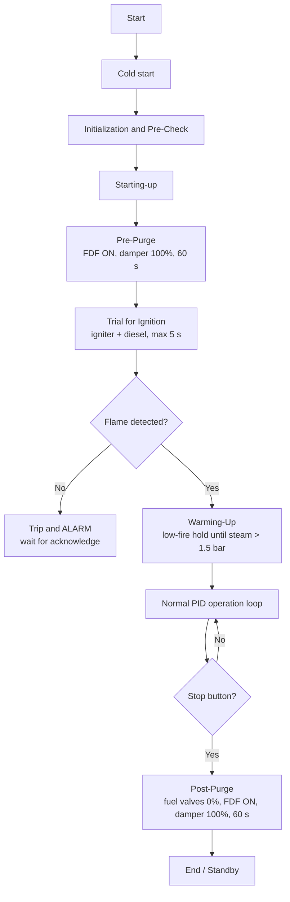

# 🔥 Boiler Combustion Control Automation (BMS + PID)


Design and simulation of an automated **combustion control system** for an industrial **dual-fuel (residue oil and diesel) steam boiler** at PPSDM Migas Cepu. The project covers a **Burner Management System (BMS)** safety sequence, a **closed-loop PID** steam-pressure controller, and an operator **HMI**, validated with **Software-in-the-Loop (SIL)** and **Hardware-in-the-Loop (HIL)** simulation.

Developed during a one-month field internship (Praktik Kerja Lapangan, PKL) at Pusat Pengembangan Sumber Daya Manusia Minyak dan Gas Bumi (PPSDM Migas) Cepu.

> ⚠️ **Simulation project.** This logic was tested only in a software simulator and on a PLC trainer with potentiometers standing in for process signals. It has **not** been commissioned on a live boiler and must not be used on real combustion equipment without proper engineering review and hot commissioning.


---

## 🎯 Project Goals

- Automate the safety-critical start-up and shutdown sequence of the boiler burner (BMS).
- Regulate steam pressure with a closed-loop PID controller that drives the fuel valves and the forced draft fan (FDF) damper.
- Provide an operator HMI for start/stop, status monitoring, process values and alarm indication.
- Verify the safety logic virtually (SIL), then verify the control-loop response on physical hardware (HIL).

---

## 🔁 Control Sequence (BMS)



| Stage | What happens |
|---|---|
| **Pre-Check (start permissive)** | Start is allowed only if water level is normal, no flame is detected (no false flame), atomization pressure is OK, and residue temperature is above 90 °C. Otherwise the ON command is blocked. |
| **Pre-Purge** | FDF starts and the damper opens to 100% for 60 s to clear residual gas from the furnace. The damper then returns to the low-fire position. |
| **Trial for Ignition (TFI)** | Igniter transformer energizes and the diesel valve opens slightly. A 5 s timer limits the flame-detection window. Flame detected → flame is latched and the sequence moves to Warming-Up. No flame → the cycle aborts, all valve outputs are cut and the ALARM lamp lights. |
| **Warming-Up** | Low-fire hold until steam pressure exceeds 1.5 bar. |
| **Normal operation** | Residue atomization is checked (alarm if not OK). A pressure PID computes the manipulated variable (MV), which is distributed to the FDF damper and split between the diesel and residue valves according to the configured fuel ratio. |
| **Post-Purge** | On the OFF command both fuel valves close to 0%. The FDF keeps running with the damper fully open for 60 s to sweep unburned gas out of the furnace, then FDF stops and the damper returns to 0%. |

---

## 🧩 Architecture

The same flowcharts drive both implementations so the safety sequence is identical.

### 1. Software-in-the-Loop (Omron CX-One)

- **CX-Programmer:** ladder logic organized in sections (initialization, Pre-Check, Pre-Purging, Trial for Ignition, Warming-Up, Normal Operation, Post-Purging, ADC scaling, analog output).
- **CX-Designer:** operator HMI.
- **CX-Simulator:** virtual test environment connecting the logic and the HMI in real time.
- Timers (`TIM`) and latching memory (`KEEP` / holding area) handle Pre-Purge, TFI and flame latching.
- Analog scaling with `SCL` for steam pressure and residue temperature.
- PID implemented with the `PIDAT` (PID with autotuning) instruction.

**Key memory map (Working area):**

| Address | Symbol | Description |
|---|---|---|
| `W30.00` | `Pre_Check_OK` | All start permissives satisfied |
| `W30.01` | `Pre_Purging` | Pre-purge flag |
| `W30.02` | `Trial_Ignition` | Trial-for-ignition flag |
| `W30.03` | `Normal_Operation` | PID operation flag |
| `W30.04` | `Post_Purging` | Post-purge flag |
| `W30.05` | `Master_Trip` | Master trip |
| `W31.00` | `WARMING_UP` | Warming-up flag |
| `W50` | `AN_SOLAR_VALVE` | Diesel valve command (0–4000) |
| `W60` | `AN_RESIDUE_VALVE` | Residue valve command (0–4000) |
| `W70` | `DAMPER` | FDF damper command (0–4000) |
| `W120.00` | `RELAY_FDF` | FDF motor contactor output |
| `W120.03` | `IGNITOR` | Igniter output |
| `W120.04` | `ALARM` | Alarm output |

### 2. Hardware-in-the-Loop (Allen-Bradley trainer, RSLogix 5000)

- The logic is rebuilt from the same flowcharts using **tag-based addressing** (REAL / DINT / BOOL tags and aliases to I/O points).
- Sequence logic lives in the Main Routine, with the PID in a separate routine called through `JSR`.
- The **PID instruction runs in a Periodic Task** (fixed 250 ms cycle) so the sampling period is constant, rather than in the Continuous Task whose scan time varies.
- Physical test rig:
  - 2 potentiometers → analog inputs (0–10 V) simulating steam-pressure feedback (PV) and setpoint.
  - 2 analog voltmeters ← analog outputs (0–10 V) showing the control variable for the fuel valve and the air damper.
  - Pushbuttons, selector switches and indicator lamps for sequence status.

### HMI (CX-Designer)

- ON / OFF buttons and Start Auto Tuning.
- Sequence status lamps: Pre Check, Pre Purging, Trial for Ignition, Warming Up, Normal Operation, Post Purging.
- Interlock and actuator lamps: Water Level, Residue Temp OK, Atomization Press OK, Flame Detector, FDF, Ignitor, and a large ALARM indicator.
- Numeric displays: residue temperature, minimum residue temperature, PID MV, load, solar ratio, steam pressure setpoint and actual.
- Animated gauges for diesel valve, residue valve and FDF damper opening, plus a level-meter bar for steam pressure.

---

## 🧪 Test Results

### SIL: CX-Simulator (safety sequence)

| Test | Result |
|---|---|
| Start permissive | Pre-Check lamp turns green only when all conditions are met. With residue temperature below 90 °C the ON command is blocked by the interlock. ✅ |
| Pre-Purge | FDF output activates, damper goes to 100%, a 60 s countdown timer runs. ✅ |
| Trial for Ignition, flame detected | Flame is latched before the 5 s window ends, igniter turns off, sequence moves to Warming-Up. ✅ |
| Trial for Ignition, flame failure | After 5 s without flame the cycle aborts, valve outputs are cut and ALARM lights. ✅ |
| Post-Purge | Fuel valves close, FDF stays on with damper open, then everything returns to standby after the timer. ✅ |
| PID (`PIDAT`) | ⚠️ **Not executable in CX-Simulator.** MV (`D200`) stayed at 0 with no instruction error flag. The instruction needs a hardware timer interrupt that the simulator does not support, so closed-loop validation was moved to HIL. |

### HIL: Allen-Bradley trainer (PID response)

| Test | Result |
|---|---|
| PV below setpoint (pressure drop) | Positive error → output voltage rises proportionally, opening fuel valve and damper further. ✅ |
| PV above setpoint (pressure overshoot) | Negative error → output falls toward 0 V, reducing fuel supply. ✅ |
| Signal stability | Output was stable and linear, with no oscillation. ✅ |

```text
e  = SP − PV
CV = Kp × e + Bias
```

**Why proportional-only:** the trainer has no real steam-generation dynamics (PV is moved by hand). With integral action, a steady error would accumulate and drive the output to saturation (integral windup), so `Ti = 0` and `Td = 0` were used for this test.

---

## ⚖️ Scope & Limitations

- Validated by simulation and a PLC trainer only. No live boiler testing.
- Plant-specific boiler data and specifications are intentionally omitted from this repository.
- PID tuning covers the proportional gain only. Integral and derivative tuning requires hot commissioning on the real thermal process.
- Feed-water / drum-level control is not part of this project.
- The closed-loop response was not demonstrated in SIL because of simulator limitations (see above).

### Future Work

- Use a thermal process simulator, or a PLC simulator with full PID support, to evaluate the closed loop virtually before hardware tests.
- Integrate three-element drum level control into the same PLC architecture.
- Run staged hot commissioning on the real instruments and tune Ti and Td against the actual furnace dynamics.

---

## 📂 Repository Structure

> 💡 Suggested layout for the new repository. Adjust it to match your actual files. The ladder programs are original work and are published here; plant-specific boiler data is intentionally left out.

```text
├── Omron_CX-One/
│   ├── Ladder/            # CX-Programmer project (.cxp)
│   └── HMI/               # CX-Designer project
├── AllenBradley_RSLogix5000/
│   └── Otomasi_Boiler.ACD # RSLogix 5000 project
├── docs/
│   ├── report/            # PKL report (PDF)
│   ├── flowcharts/
│   └── images/
├── README.md
└── LICENSE
```

---

## 🛠️ How to Open the Projects

| Project | Software |
|---|---|
| Omron ladder logic | CX-Programmer (CX-One) |
| Omron HMI | CX-Designer |
| Virtual test | CX-Simulator (part of CX-One) |
| Allen-Bradley logic | RSLogix 5000 / Studio 5000 Logix Designer |

1. Open the Omron project in CX-Programmer and start CX-Simulator.
2. Open the HMI project in CX-Designer and run it in test mode connected to the simulator.
3. For HIL, open the RSLogix 5000 project and download it to the trainer's controller. Verify the I/O module configuration matches your hardware first.

---

## 📚 References and Standards

- JIS B-8201:2019, *Stationary steel boilers – Construction*
- NFPA 85, *Boiler and Combustion Systems Hazards Code*
- Omron CP-series CPU unit manuals and CX-Designer user's manual
- Rockwell Automation, *Logix 5000 Controllers General Instructions Reference Manual*
- Dukelow, *The Control of Boilers*; Smith & Corripio, *Principles and Practice of Automatic Process Control*; Lipták, *Instrument Engineers' Handbook*

---

## 👤 Author

**Tegar Bayu Segara**, S1 Teknik Elektro, Universitas Sebelas Maret
PKL at PPSDM Migas Cepu

---

## 📄 License

See [LICENSE](LICENSE).
